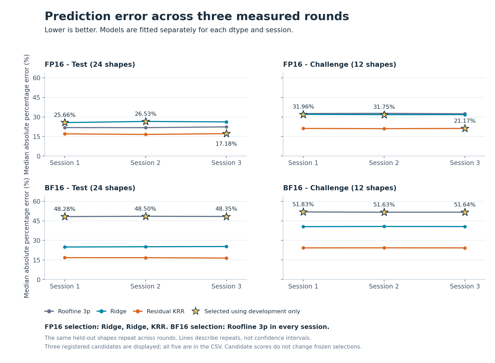

# Transformer Linear Layer Performance Predictor

**Initial release: v1.0.0**

Predict the latency of the matrix multiplications used in Transformer linear layers from their dimensions. The project combines a Python/PyTorch CUDA benchmark, five latency models, frozen held-out predictions, and a CPU-verifiable record of six NVIDIA A100 sessions.

The central finding is that stable timing and accurate prediction are separate problems. The recorded measurements were consistent across sessions, while selecting the lowest development-set error did not consistently select the strongest held-out model. The repository preserves that result, including unsuccessful predictions and timing qualifications.

## What it measures

```python
torch.mm(X, W.T, out=Y)
# X: [M, K], W: [N, K], Y: [M, N]
```

The target is **warm-reuse CUDA Graph replay time per GEMM**: CUDA events surround one replay containing 50 matrix multiplications, and elapsed time is divided by 50. Each shape has three measurement blocks, with nine replay samples per block. Its label is the median of the three block medians.

GPU reads and writes performed by the GEMM are included. Allocation, CPU-to-GPU transfers, graph capture, and correctness checks are outside the timed region. Replay and inter-kernel gaps remain inside the measurement. The target is neither an isolated kernel duration nor end-to-end Transformer inference latency.

## Included in the release

- **96 modeling and acquisition shapes**, plus eight diagnostic-only shapes. The same shapes are repeated across six sessions; they are not six independent shape datasets.
- **FP16 and BF16 measurements on A100-SXM4-40GB**, with three distinct recorded GPU UUIDs and a precision pair on each device.
- **Five predictors:** FLOP-only, two-parameter Roofline, three-parameter Roofline, shape-feature ridge regression, and a Roofline model with a kernel ridge residual correction.
- **Development-only selection:** all main models use 24 calibration labels; 12 development shapes select hyperparameters and the official model. Predictions for 24 test and 12 challenge shapes are frozen before their measurements are collected.
- **Auditable evidence:** raw replay samples, measurement schedules, drift controls, saved numerical witnesses, frozen predictions, all candidate metrics, and publication checksums.

## Recorded results

These are the **official models chosen before held-out evaluation**, not the best model selected after inspecting test results. APE is absolute percentage error; lower is better.

| Session | Selected model | Development median APE | Test median APE | Challenge median APE |
|---|---|---:|---:|---:|
| FP16 s01 | Shape-log Ridge | 13.72% | 25.66% | 31.96% |
| FP16 s02 | Shape-log Ridge | 14.12% | 26.53% | 31.75% |
| FP16 s03 | Roofline + residual KRR | 13.96% | 17.18% | 21.17% |
| BF16 s01 | Roofline, three parameters | 13.63% | 48.28% | 51.83% |
| BF16 s02 | Roofline, three parameters | 13.47% | 48.50% | 51.63% |
| BF16 s03 | Roofline, three parameters | 12.77% | 48.35% | 51.64% |

Source: [selected-pipeline data](results/summary/selected_pipeline.csv). The registered residual KRR candidate achieved **16.44-17.18% test median APE** across the six sessions, but it was the official selection only in FP16 s03. Its candidate scores do not replace the selections above. Tail errors remain substantial; see [full results and limitations](docs/RESULTS.md) and [all model metrics](results/summary/model_metrics.csv).



The chart shows three of the five registered candidates; stars mark the development-selected models. The same held-out shapes repeat across rounds. Lines connect repeated-session scores, not confidence limits or new test sets.

Each recorded session passed 5,468 internal audit checks and the declared timing gates. BF16 s03 still contains a visible **17.24% control-time span** under a 20% gate. Passing a gate establishes neither absence of drift nor predictive accuracy.

## Quick start on a CPU or Mac

From the repository root, use Python 3.11 or newer:

```bash
python3 -m venv .venv
source .venv/bin/activate
python -m pip install -r requirements-analysis-lock.txt
python -m pip install --no-deps -e .
python scripts/verify_published_results.py
```

This checks the published evidence without rerunning a GPU benchmark. Read the CSVs under [`results/summary/`](results/summary/) and the [results report](docs/RESULTS.md). The separate [Review_Results.ipynb](notebooks/Review_Results.ipynb) audits new native run archives produced by the benchmark notebook.

## Collect a new GPU session

A CUDA-capable NVIDIA GPU and a compatible PyTorch installation are required. The analysis dependencies do not install or replace PyTorch. Run preflight checks before collecting a fresh session:

```bash
python -m linear_perf doctor --config configs/fp16_graph.json
python -m linear_perf run \
  --config configs/fp16_graph.json \
  --out runs/fp16_s01 \
  --session-id fp16_s01
python -m linear_perf audit --run runs/fp16_s01
```

Use `configs/bf16_graph.json` for native BF16-capable hardware. Each run needs a new output directory. For Colab, use [Run_Benchmark.ipynb](notebooks/Run_Benchmark.ipynb). The [reproduction guide](docs/REPRODUCIBILITY.md) covers simulation, multi-session comparisons, packaging, and the difference between verifying published evidence and auditing a newly collected run.

## Read the project

| Topic | Location |
|---|---|
| Measurement boundary, splits, diagnostics, and evaluation rules | [Protocol](docs/PROTOCOL.md) |
| Model formulas, features, fitting, and prediction limits | [Models](docs/MODELS.md) |
| Six-session findings, tails, transfer, and qualifications | [Results](docs/RESULTS.md) |
| Installation, commands, provenance, and future experiments | [Reproducibility](docs/REPRODUCIBILITY.md) |
| Public dataset layout and checksums | [Dataset guide](results/README.md) |
| Official technical references | [References](docs/REFERENCES.md) |

## Scope of the evidence

The release covers one GPU model and software stack, synthetic dense inputs, one layout, and a warm-reuse execution contract. FP16 was measured before BF16 within each pair, so precision and runtime order are not fully separated. No DRAM or SM hardware counters, cross-architecture validation, complete TensorRT engine, or online LLM serving measurements are included.

The useful output is a reproducible benchmark and a measured account of where shape-based prediction succeeds or fails. Generalizing to another GPU, library version, cache policy, or application requires new measurements under an explicit evaluation plan.
