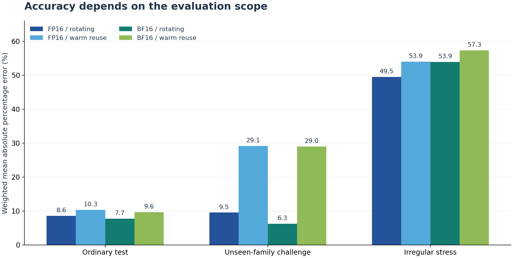

# Transformer Linear Layer Performance Predictor

Measure and predict the latency of dense GPU matrix multiplications used in Transformer linear layers. The Python/PyTorch pipeline retains raw timing samples, numerical-check records, model-selection evidence, per-case predictions, and repeat measurements.

## Measured results — v1.1.0

The **6 November 2026 A100-SXM4-40GB experiment completed every requested stage**: a 609-shape primary collection, training-only model selection and refitting, held-out evaluation, a predetermined 77-shape repeat, and a comparison using the unchanged primary models. The workload includes model-configuration-derived shapes and a separate artificial irregular-dimension stress set.

The selected predictor is a Roofline model with a kernel-ridge residual correction in all four precision/cache contexts. The following values are **weighted mean absolute percentage errors**:

| Precision / buffer policy | Ordinary test | Unseen-family challenge | Irregular stress |
|---|---:|---:|---:|
| FP16 / four-buffer rotation | 8.56% | 9.53% | 49.47% |
| FP16 / warm reuse | 10.32% | 29.15% | 53.94% |
| BF16 / four-buffer rotation | 7.71% | 6.26% | 53.93% |
| BF16 / warm reuse | 9.64% | 28.97% | 57.31% |

Ordinary tests use unseen M values in `(N,K)` families represented in training. Challenge holds out whole `(N,K)` families; stress changes N and K by +1. Weights describe architectural operation occurrences under a declared synthetic mixture, not observed production traffic. Rotation and warm reuse have different eligible cohorts and separately fitted models.



**Completion has timing-quality qualifications.** Six of 2,256 primary aggregate rows exceed the between-visit threshold; one of six repeat control groups also exceeds its threshold. All flagged data remain included. Median absolute changes in the repeat are 1.18%–1.61%, with a maximum of 28.19%. These observations do not establish uniform stability or accuracy for arbitrary shapes.

[Full results and limitations](docs/RESULTS.md) · [Evidence guide](experiments/a100_20261106/README.md) · [Selected-model metrics](experiments/a100_20261106/selected_model_metrics.csv) · [Complete results ZIP](experiments/a100_20261106/results.zip) · [Detailed HTML review](experiments/a100_20261106/review.html)

## Measurement scope

The target is `Y[M,N] = X[M,K] @ W[N,K].T`, executed with preallocated `torch.mm(..., out=Y)` inside CUDA Graphs. Each CUDA-event interval is divided by the recorded number of GEMM operations. Labels are medians of nine samples per visit and three visits per case/context.

GPU reads, writes, and gaps visible inside the replay interval contribute to the target. Allocation, host-device transfers, graph capture, warmup, model loading, and serving queues are outside it. Separate profiling records observed kernel names after timing; profiling is excluded from labels and predictor features. Hardware performance counters were not collected.

Warm reuse repeatedly uses the same buffers. Eligible rotation cases alternate four buffer sets; this does not guarantee cold-cache execution or measured HBM traffic. The optional decoder-layer experiment was not requested in this published run. The results describe the stated GEMM experiment, with no full-model or serving-system latency claim.

## Inspect the published experiment on a CPU or Mac

Python 3.11 or newer is required. Install the analysis environment from the repository root:

```bash
python3 -m venv .venv
source .venv/bin/activate
python -m pip install -r requirements-analysis-lock.txt
python -m pip install --no-deps -e .
```

Extract the recorded archive into a new local directory and audit both datasets:

```bash
python -m zipfile -e experiments/a100_20261106/results.zip runs/published_a100_20261106
python -m linear_perf audit --run runs/published_a100_20261106/run/primary
python -m linear_perf audit --run runs/published_a100_20261106/run/repeat
```

Open **`runs/published_a100_20261106/run/report.html`** in a browser. The archive contains raw records, all candidate predictions, fitted models, environment information, traces, and the exact source archive used by the measured run. The audits recompute record consistency; they do not execute new GPU work or change the timing-quality flags. Download the standalone [HTML review](experiments/a100_20261106/review.html) to read its charts and audit notes locally.

For an explicitly simulated software demo:

```bash
python scripts/run_demo.py --out runs/smoke
```

The demo checks the workflow and report generation. Its simulated times do not establish GPU performance.

## Run a new complete experiment

Start with [START_HERE.md](docs/START_HERE.md) and upload [Run_Experiment.ipynb](notebooks/Run_Experiment.ipynb) to Colab. Select a compatible NVIDIA GPU and run the notebook's cells in order. The standalone notebook embeds source code and model-configuration snapshots; it needs no previous measurements or trained predictor.

Keep the default primary/repeat workflow, authorize the Google Drive mount, and check that the initial backup is verified before collection begins. Every attempt receives a new experiment ID. The notebook preserves the assigned runtime's PyTorch/CUDA installation and saves verified checkpoints at declared boundaries outside CUDA-event timing intervals.

From a checkout with CUDA-enabled PyTorch, the equivalent complete experiment is:

```bash
python -m linear_perf doctor
python -m linear_perf experiment --config configs/workloads.json   --out runs/fresh_s01 --session-id fresh_s01
```

For direct CLI backups, supply `--checkpoint-directory` with an experiment-specific persistent destination as described in [REPRODUCIBILITY.md](docs/REPRODUCIBILITY.md). Each run produces one final results ZIP. Completion, timing quality, and final-backup success are separate outcomes. Runtime depends on the assigned hardware and actual execution; a time budget is a cap, not a promised duration.

After a lost connection or replaced Colab runtime, use [Download_Saved_Results.ipynb](notebooks/Download_Saved_Results.ipynb) on CPU to retrieve the saved result or latest verified checkpoint. It does not require the previous Python `result` variable. Checkpoints preserve completed evidence and its status; they do not automatically resume partial experiments. See [COLAB_RECOVERY.md](docs/COLAB_RECOVERY.md).

`Run_Benchmark.ipynb` is a compatibility copy of the complete experiment notebook. A small hardware check is available through `configs/workloads_smoke.json`. Separate collection and analysis commands, transfer, and optional layer validation are documented in [REPRODUCIBILITY.md](docs/REPRODUCIBILITY.md).

## Modeling and evaluation

The pipeline collects every split before fitting. It uses training-only grouped cross-validation by `(N,K)` family, fits preprocessing within each fold, selects configurations and a model family, and refits on all eligible training rows. Test, challenge, stress, and repeat labels never enter model fitting or selection. Measuring held-out labels after model freezing is not required.

Five candidate families are compared: FLOP-only, two-parameter Roofline, three-parameter Roofline, shape-log Ridge, and Roofline with a kernel-ridge residual correction. Selection uses out-of-fold weighted mean APE, with weighted P90 as the tie-break. The report also retains unweighted mean, median, tail, worst-case, and absolute-time errors.

The learned models use shared geometric features and declared SM count. Candidate-tile features describe possible wave utilization; they do not assume the tile or kernel chosen by the runtime. Predicting an unseen shape does not require profiling it first. See [MODELS.md](docs/MODELS.md) and [PROTOCOL.md](docs/PROTOCOL.md).

## Current limitations

- **Small-matrix predictions:** the residual multiplier is clipped to 0.25–4. This bound limits several narrow ordinary-test cases; their largest errors are retained.
- **Irregular dimensions:** training alignment indicators are constant zero, while the separate stress cases exercise unseen alignment states. Their high errors expose a training-coverage limitation.
- **New families under warm reuse:** challenge weighted mean error is about 29%; the selected KRR does not outperform every comparator on every evaluation scope.
- **Measurement repeatability:** the repeat is a subset measured later in the same session on the same recorded GPU. It does not establish cross-day or cross-architecture transfer, and the quality flags remain visible.
- **Scope and uncertainty:** no calibrated per-shape prediction intervals, measured cache-hit rates, production workload frequencies, or full-model latency validation are provided.

These findings guide future model and data revisions. The published experiment and its model choices are retained unchanged. See [RESULTS.md](docs/RESULTS.md) for concrete failure cases and the limits of the evidence.

## Validation

```bash
OMP_NUM_THREADS=1 OPENBLAS_NUM_THREADS=1 python -m unittest discover -s tests -v
python scripts/verify_published_results.py
python release_tools/build_release.py --out dist --notebook-dir notebooks
python dist/linear_perf_colab.py --self-check
```

CPU checks exercise software, data-use boundaries, evidence consistency, and packaging. GPU findings come from the separately recorded hardware experiment. [VALIDATION.md](docs/VALIDATION.md) distinguishes those checks and their limits; [REFERENCES.md](docs/REFERENCES.md) lists methodological sources.

## Earlier evidence

The six first-release A100 sessions remain under [`results/`](results/README.md), with their original measurements, model selections, and checksums. Their [baseline results](docs/BASELINE_RESULTS.md) and [baseline protocol](docs/BASELINE_PROTOCOL.md) are separate from the current 609-shape experiment.

The [retrospective selection review](analysis/review_selection/README.md) analyzes known baseline labels. It is not new held-out evidence and does not replace the original decisions. Differences between the old and current workloads are not used to claim a causal accuracy improvement. The [design-review response](docs/REVIEW_RESPONSE.md) records the implementation decisions and remaining evidence boundaries.
