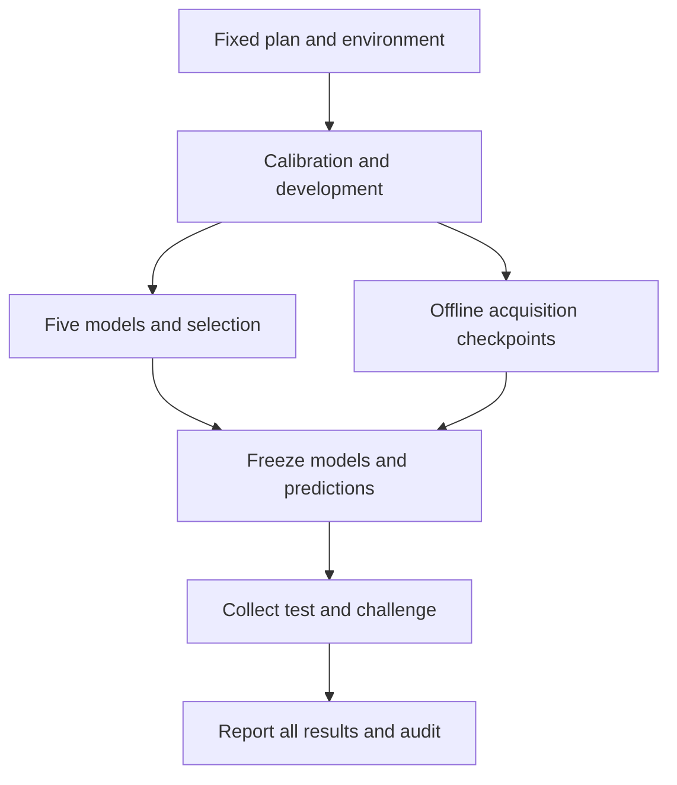

# Measurement and Evaluation Protocol

This document defines the v1.0.0 experiment. The executable plan is in [`linear_perf/protocol.py`](../linear_perf/protocol.py), with separate [FP16](../configs/fp16_graph.json) and [BF16](../configs/bf16_graph.json) configurations. Recorded outcomes are reported separately in [BASELINE_RESULTS.md](BASELINE_RESULTS.md).

## 1. Prediction target

For a fixed GPU, software stack, dtype, layout, and execution policy, estimate the device time of:

```python
torch.mm(X, W_T, out=Y)
# X is contiguous [M, K]; W is contiguous [N, K].
# W_T = W.t() is prepared before timing; Y is contiguous [M, N].
```

Inputs and outputs are preallocated. Execution uses inference mode with autocast disabled. Inputs are generated from normal distributions; X is scaled by `1 / sqrt(K)` before casting to the target dtype. Main measurements reuse the same input, weight, and output addresses.

The timer surrounds a CUDA Graph replay containing 50 GEMMs. The recorded event duration is divided by 50 to form one sample. This includes the GPU's input, weight, and output accesses and any replay/inter-kernel gaps inside the event interval. It excludes allocation, host-device transfers, capture, reference computation, and service queues.

This workload omits bias, activation, attention, residual connections, and full-model scheduling. A matching matrix shape alone does not establish that an application has the same cache state or execution cost.

## 2. Measurement hierarchy

| Level | Definition | How it is used |
|---|---|---|
| Captured operation | One GEMM inside the graph | 50 operations share a replay interval |
| Replay sample | Event elapsed time divided by 50 | Nine samples are retained for each visit |
| Block visit | One scheduled measurement of a shape | Its label is the median of nine samples |
| Shape target | Three block visits of the same shape | Median of the three block medians |
| Session | One collection under a recorded environment | Its own calibration, selection, and held-out evaluation |

The 50 operations in a replay are not 50 independent experiments. Replays and blocks within a session also do not create independent GPU sessions.

### Fixed measurement settings

| Setting | Value |
|---|---|
| Execution / cache policy | `cuda_graph` / `warm_reuse` |
| Eager warmup | 20 calls |
| GEMMs per captured graph | 50 |
| Replay samples per visit | 9 |
| Minimum graph warmup | At least 5 replays and 250 ms of elapsed wall time |
| Warmup cap | 4,096 replays |
| Blocks | 3, with a seeded shuffle in each block |
| Aggregation | Median of block medians |
| Control shapes | `x01`, `x03`, `x06` |
| Control schedule | Stage boundaries and after every eight work visits |
| Telemetry | Visit-boundary snapshots, at most once per second |
| Main campaign deadline | 1,800 seconds, enforced cooperatively |

Warmup has a fixed stopping rule; the code does not warm up until a favorable quality score appears. The duration is wall time, not a measurement of GPU busy time or proof of steady clocks. Budget, cap, and deadline failures are preserved.

CUDA event timing and graph replay follow the execution principles described in [PyTorch's CUDA documentation](REFERENCES.md#execution-and-timing). The values in the table are this project's declared design choices.

## 3. Shapes and data permissions

There are **104 unique registered `(M, N, K)` triples**: 96 modeling/acquisition shapes and eight diagnostics.

| Role | IDs | Count | Permitted use |
|---|---|---:|---|
| Calibration | `c01`-`c24` | 24 | Fit all five main model families |
| Development | `d01`-`d12` | 12 | Select hyperparameters, model family, and acquisition checkpoints |
| Test | `t01`-`t24` | 24 | Evaluate frozen predictions |
| Challenge | `h01`-`h12` | 12 | Evaluate frozen predictions on held-out `(N, K)` families |
| Acquisition pool | `a01`-`a24` | 24 | Reveal labels to offline acquisition policies under fixed budgets |
| Diagnostic | `x01`-`x08` | 8 | Timing controls and separate diagnostics only |

Diagnostic rows use `split="candidate"` for transport, but their role excludes them from fitting, selection, and acquisition. Code must consult the registered role; filtering by `split` alone is insufficient.

### Family coverage

Calibration, development, test, and acquisition use these six `(N, K)` families:

```text
(1024, 768)   (1536, 1024)   (4096, 2048)
(8192, 6144)  (1537, 1025)   (4097, 2049)
```

| Split | M values in each family |
|---|---|
| Calibration | 1, 16, 128, 1024 |
| Development | 8, 256 |
| Test | 3, 48, 384, 1536 |
| Acquisition pool | 2, 32, 96, 768 |

The test cases introduce new M values within known families. M = 1536 exceeds the calibration maximum, so part of the test is extrapolation rather than interpolation.

Challenge uses four separate families, each with M = 5, 192, 1152:

```text
(2048, 1536)  (6144, 4096)  (2049, 1537)  (6145, 4097)
```

These four families are absent from calibration, development, and the acquisition pool. Regular and irregular dimensions appear on both sides of the split. Reports group shapes by M range, family, and whether N/K are multiples of 16. Those are geometric features, not observations of Tensor Core use or actual kernel tile dimensions.

## 4. Quality and correctness

The declared timing conditions are:

- Within-visit coefficient of variation at most 10%.
- Maximum/minimum block-median ratio at most 1.2.
- Maximum/minimum repeated-control median ratio at most 1.2.

These are descriptive engineering gates, not statistical significance tests or NVIDIA/MLPerf certification criteria. Timing warnings are retained and qualify conclusions. They do not trigger sample deletion, favorable-pass selection, threshold changes, or automatic retries. Numerical failures, non-finite values, invalid provenance, resource failures, incomplete evidence, and held-out isolation violations stop the run.

Each main case is checked against an IEEE FP32 reference computed from the same already-represented FP16/BF16 inputs. Correctness checking occurs outside the timing interval. The environment records precision policy, including reduction settings. This checks the stated matrix operation, not the accuracy of a downstream language model.

Four small numerical witnesses use zero, identity, alternating-sign, and seeded-random patterns. The measured inputs, output, and FP32 reference are saved as NPZ arrays. A CPU audit recomputes a reference in FP64 and verifies shape, representability, tolerances, patterns, and hashes. These witnesses make those saved cases independently inspectable; they do not preserve every large output matrix or attest execution on a particular physical device.

## 5. Separate diagnostics

Diagnostic measurements are excluded from all model labels.

| Diagnostic | Design | Interpretation boundary |
|---|---|---|
| Execution/replay sensitivity | Eight diagnostic shapes, eager/graph execution, 25/50/100 operations, two passes | Reveals sensitivity to execution contract and replay size; does not isolate every launch-overhead cause |
| Graph profiling | Warmed graph replay for `x02` and `x06` | Inspect execution paths and timelines; never substitute profiler durations for primary labels |
| Working-set rotation | `x02` and `x03`, one/four buffer sets, two passes | Changes reuse patterns; is not a cache flush |
| Numerical witnesses | Four small deterministic input patterns | Supports CPU rechecking of stored outputs |

Telemetry is a coarse snapshot outside the event interval. It cannot establish the clock or temperature of each microsecond-scale replay. The release contains no measured DRAM or SM performance counters. Unavailable profiler information is recorded as unavailable.

## 6. Fit, select, freeze, evaluate

All five main models use the same 24 calibration targets. Development labels select ridge/KRR hyperparameters and the official model; they are not added to the final training set. The selection rule is lowest development median APE, then development P90 APE, then fixed model order.



The freeze stores concrete per-case predictions, model payloads, and acquisition checkpoints before held-out collection begins. The run records chronology and a held-out claim marker. An interrupted or failed run must remain inspectable; deleting its marker and rerunning to select a better outcome would violate the protocol.

Reporting all registered model scores after evaluation is useful, but it does not authorize replacing the official selection. Future changes informed by these published outcomes need a new untouched evaluation set to support a fresh prospective accuracy claim.

## 7. Offline acquisition experiment

Acquisition compares a nearest-shape heuristic with uniform random selection without replacement. Both use the same two-parameter Roofline baseline, the same measured pool, and the same development set.

The full 24-label pool is collected first. During policy replay, unrevealed labels remain hidden from the selector. A round reveals two labels; checkpoints are at 2, 4, 8, and 12 acquired labels for each of ten declared seeds. The heuristic targets the development shape with the largest error and chooses unused candidates nearby in L1 distance over `log2(M, N, K)`.

A trial model is accepted only when development median APE strictly improves. Otherwise the current model is retained. Acquired labels remain available to later trial fits even when an individual update is rejected. Every checkpoint is frozen before held-out evaluation, and all budgets/seeds are reported.

The seeds describe policy variation over a shared measured pool. They are not independent hardware runs. Because the full pool was collected, the experiment does not demonstrate a reduction in actual GPU collection time.

## 8. Evaluation and uncertainty

The unit of prediction evaluation is one distinct shape target. Reports include median, mean, P90, and worst APE; MAE and RMSE; signed bias; log errors; pairwise ordering; and per-shape predictions with observed block ranges. P90 APE is a percentile of shape prediction errors, not a percentile of request latency.

Pairwise ordering excludes measured near-ties within 1%; this does not incorporate every source of timing uncertainty. Shape-domain warnings flag axis extrapolation, unseen N/K families, and distance from the calibration set. They are diagnostics, not calibrated probabilities of failure.

The selected model is compared with the three-parameter Roofline baseline using 1,000 paired resamples of N/K-family clusters. The reported middle 95% percentile range is descriptive. Six test families and four challenge families provide limited evidence; the interval is neither a prediction interval nor guaranteed population coverage. Repeated event samples are not resampled as if they were independent GPU sessions.

## 9. Session, precision, and transfer boundaries

A three-session study reports separately fitted results and transfers the first supplied session's frozen models to the other two. Source selection is fixed by input order. Repeating the registered shapes tests session stability, not new-shape generalization.

An explicit transfer analysis supports zero, four, or eight target calibration labels. Four/eight labels are selected by a shape-only farthest-point order. Each frozen source model gets at most one multiplicative scale:

$$
s = \exp\left(\frac{1}{n}\sum_i \log\frac{t_i}{\hat t_i}\right).
$$

Target development/test labels do not select this scale or the source model. The mode must declare whether hardware is allowed to differ. The bundled evidence evaluates one GPU model; the existence of a cross-GPU analysis command is not cross-architecture validation.

FP16 and BF16 retain separate plans, labels, and models. A precision comparison requires a matching recorded physical GPU identity and compatible software/measurement policies. It reports FP16 time divided by BF16 time. Sequential dtype runs still permit runtime-order and state confounding.

## 10. Evidence identities

Each native run records a full plan hash, a measurement-contract signature, an environment identity, a session ID, and source/dependency identities. These serve different purposes: a matching timer signature does not make two environments interchangeable, and a new session name does not prove a new GPU.

Raw blocks, schedules, aggregates, controls, models, and frozen predictions are retained. Audits recompute coverage, internal hashes, aggregation, quality conditions, metrics, acquisition decisions, numerical witnesses, and freeze/collection chronology. A content hash establishes byte consistency, not a third-party attestation.

The bundled public snapshot has its own checksums and verifier. See [Reproducibility](REPRODUCIBILITY.md#published-evidence-and-source-provenance) for the distinction between recorded evidence identities and the source identity of this release.
