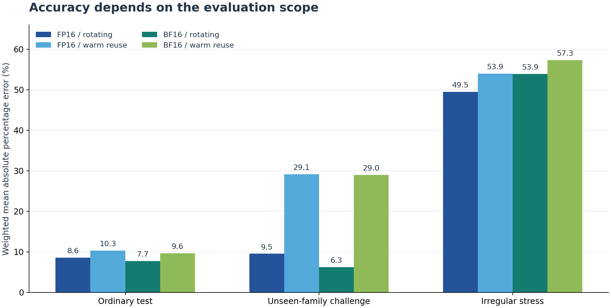

# Results: A100 Experiment — v1.1.0

The **6 November 2026** experiment completed the requested primary collection, model selection/refit, held-out evaluation, predetermined repeat, and repeat comparison. The selected models achieve **7.71%–10.32% weighted mean absolute percentage error on ordinary held-out tests**, with larger errors on warm unseen-family challenges and irregular dimensions. Timing-quality flags remain part of the result.

[Evidence guide](../experiments/a100_20261106/README.md) · [Complete original results ZIP](../experiments/a100_20261106/results.zip) · [Selected-model metrics](../experiments/a100_20261106/selected_model_metrics.csv) · [All-candidate metrics](../experiments/a100_20261106/metrics.csv) · [Detailed HTML review](../experiments/a100_20261106/review.html)

Earlier six-session results remain in [BASELINE_RESULTS.md](BASELINE_RESULTS.md).

The archive is the source for raw samples, predictions, environment records, fitted models, traces, and the exact source snapshot. Paths shown below are relative to that archive. Download and extract it, then open `run/report.html` for the original combined report. The separate HTML review contains offline recomputations and diagnostic findings; download it to open locally.

## 1. Run scope and completion

| Item | Recorded result |
|---|---|
| Session | `fresh_20261106T065308_c5e789` |
| Protocol version | `1.1.0` |
| GPU | NVIDIA A100-SXM4-40GB, 108 SMs, 40 MiB recorded L2 |
| Python / PyTorch | 3.13.16 / 2.11.0+cu130 |
| CUDA runtime / driver | 13.0 / 580.82.07 |
| Precisions | FP16 and BF16, interleaved in a seeded schedule |
| Primary workload | 609 distinct shapes: 311 train, 134 test, 118 challenge, 46 stress |
| Primary observations | 2,256 aggregate rows, 6,768 raw visits, 378 control visits |
| Repeat workload | 77 predetermined shapes; 280 aggregate rows, 840 raw visits, 72 control visits |
| Worker outcome | Exit code 0; no timeout, interruption, or automatic retry |
| Worker elapsed time | 2,336.36 seconds, approximately 38 minutes 56 seconds |
| Requested stages | All completed |
| Optional decoder layer | Not requested |
| Overall timing-quality flag | `false`; exceptions are retained and described below |

Source records: `launcher_status.json`, `run/summary.json`, and `run/{primary,repeat}/dataset/environments.json`.

The target is CUDA-event elapsed time per preallocated `torch.mm(X, W.T, out=Y)` inside a repeated CUDA Graph. The event interval includes GPU reads/writes and visible launch/inter-kernel gaps, divided by the actual number of captured GEMMs. Allocation, host-device transfers, capture, warmup, numerical checks, profiling, fitting, and backup copying are outside this interval. These labels do not measure kernel-only time or full Transformer/serving latency.

Warm reuse has 609 rows per precision in primary and 77 in repeat. Four-buffer rotation has 519 and 63 respectively. All 180 primary and 28 repeat skipped precision/cache variants are deliberate `weight_exceeds_declared_L2_multiple` decisions: the weight matrix exceeds twice the recorded L2 size, or 80 MiB. Their warm measurements remain present; no memory-guard skips are recorded. Rotation does not prove cache eviction or HBM traffic.

## 2. Evaluation design

All primary splits were measured before fitting. Model selection uses six training-only cross-validation folds grouped by `(N,K)` family, with feature scaling fitted inside each fold. The selected configuration is then refitted on all eligible training rows: 266 per rotating context and 311 per warm context. Test, challenge, stress, repeat, and profiler outputs are excluded from model selection and fitting.

The four contexts each evaluate 19 configurations across five model families. All select `roofline_residual_krr` by weighted mean out-of-fold APE, with weighted P90 as the tie-break. CV scores are selection evidence rather than independent test estimates.

| Split | Question |
|---|---|
| Ordinary test | Can the predictor handle unseen M values in `(N,K)` families represented in training? |
| Challenge | Can it generalize to complete `(N,K)` families absent from training? |
| Stress | What happens when N and K are each changed by +1 to create irregular dimensions? |

Most ordinary-test cases lie within the M range observed for their family. Two warm-only vocabulary cases are M extrapolations after memory-budget exclusions: `m192_n151936_k1536` has a training-family maximum M of 128, and `m768_n151936_k896` has a maximum of 512. Their errors are 1.05%–5.79% across precisions, but together they carry only about 0.053% of ordinary-test weight. They do not establish broad extrapolation accuracy.

Source records: `run/workload_manifest.json`, `run/primary/analysis/summary.json`, and `run/primary/analysis/group_*/model_suite.json`.

## 3. Selected-model prediction errors

Per-case absolute percentage error is `100 * abs(predicted - measured) / measured`. The weighted mean uses declared architectural-operation weights under a synthetic model/layout/M mixture. It is not a runtime-weighted error, WAPE, or an estimate of actual production traffic. Stress has uniform weights. The mean, median, P90, and worst-case columns below are unweighted across cases.

| Split | Context | n | Weighted mean % | Mean % | Median % | P90 % | Worst % |
| --- | --- | --- | --- | --- | --- | --- | --- |
| test | FP16 / rotating | 113 | 8.56 | 8.97 | 4.68 | 20.87 | 70.29 |
| test | FP16 / warm | 134 | 10.32 | 9.98 | 5.96 | 23.14 | 74.70 |
| test | BF16 / rotating | 113 | 7.71 | 8.33 | 3.30 | 21.17 | 76.95 |
| test | BF16 / warm | 134 | 9.64 | 9.59 | 5.06 | 22.99 | 79.90 |
| challenge | FP16 / rotating | 100 | 9.53 | 9.80 | 5.31 | 26.81 | 47.71 |
| challenge | FP16 / warm | 118 | 29.15 | 25.04 | 16.61 | 65.19 | 90.86 |
| challenge | BF16 / rotating | 100 | 6.26 | 5.85 | 3.60 | 11.50 | 38.80 |
| challenge | BF16 / warm | 118 | 28.97 | 24.85 | 12.31 | 72.23 | 94.00 |
| stress | FP16 / rotating | 40 | 49.47 | 49.47 | 60.39 | 79.05 | 83.95 |
| stress | FP16 / warm | 46 | 53.94 | 53.94 | 62.37 | 79.39 | 85.26 |
| stress | BF16 / rotating | 40 | 53.93 | 53.93 | 66.05 | 86.43 | 91.89 |
| stress | BF16 / warm | 46 | 57.31 | 57.31 | 65.76 | 85.72 | 92.48 |



Every eligible observation remains in the metrics, including the quality-flagged rows. These are point estimates from one primary hardware collection; no calibrated per-shape prediction interval is provided. The precision/cache contexts have their own fitted models and eligible cohorts, so differences between columns do not isolate a causal cache effect.

Sources: [selected-model CSV](../experiments/a100_20261106/selected_model_metrics.csv) and `run/primary/analysis/predictions.csv` in the archive.

## 4. Same-run baseline comparisons

Ordinary-test **weighted mean APE (%)**:

| Context | FLOP-only | Roofline 2p | Roofline 3p | Shape Ridge | Selected KRR |
| --- | --- | --- | --- | --- | --- |
| FP16 / rotating | 28.95 | 30.28 | 9.43 | 11.47 | 8.56 |
| FP16 / warm | 22.23 | 34.57 | 14.78 | 17.23 | 10.32 |
| BF16 / rotating | 29.80 | 30.84 | 9.10 | 14.59 | 7.71 |
| BF16 / warm | 23.54 | 34.82 | 13.78 | 19.18 | 9.64 |

The CV-selected KRR has the lowest ordinary-test weighted mean error among the five candidates in every context. Relative to the fitted three-parameter Roofline comparator, its prediction error falls by 9.23%, 30.15%, 15.26%, and 30.06% in the table's context order. These are reductions in **prediction error**, not matrix-multiplication speedups.

The selected model does not win every held-out comparison. On warm challenge, FLOP-only has 17.75% FP16 and 18.58% BF16 weighted mean error, below selected KRR at 29.15% and 28.97%. On warm stress, shape-log Ridge has 50.80% and 55.19%, below KRR at 53.94% and 57.31%. These comparisons remain descriptive: the model selected using training CV has not been replaced after seeing held-out results.

Source: [all-candidate metrics](../experiments/a100_20261106/metrics.csv). The earlier six-session experiment used a different workload and protocol; its raw error values are not used to quantify improvement in this experiment.

## 5. Timing-quality qualifications

The declared checks require within-visit CV at most 10%, between-visit maximum/minimum at most 1.20, and control maximum/minimum at most 1.20. The global quality flag requires every row and control group to pass.

| Stage | Aggregate rows | Flagged rows | Visits over the CV threshold | Failing control groups |
|---|---:|---:|---:|---:|
| Primary | 2,256 | 6 (0.266%) | 0 / 6,768 | 0 / 6 |
| Repeat | 280 | 0 | 0 / 840 | 1 / 6 |

All six primary flags occur under warm reuse and reflect differences between visits, rather than high variation among the nine samples inside a visit:

| Case | Precision | Split | Visit medians (us) | Max/min |
| --- | --- | --- | --- | --- |
| m1_n1536_k8960 | BF16 | challenge | 25.910, 31.005, 25.669 | 1.2079 |
| m1_n1536_k8960 | FP16 | challenge | 25.583, 30.996, 25.361 | 1.2222 |
| m16_n2049_k5633 | FP16 | stress | 67.686, 55.068, 71.095 | 1.2910 |
| m1_n2048_k2048 | FP16 | train | 9.904, 10.448, 8.632 | 1.2104 |
| m1_n2048_k5632 | BF16 | train | 25.209, 20.513, 20.365 | 1.2379 |
| m1_n2048_k5632 | FP16 | train | 25.095, 20.183, 20.031 | 1.2528 |

Three flags belong to training, two to challenge, and one to stress. Ordinary-test rows have no direct quality flags, but the three flagged training rows may influence fitted models. Maximum within-visit CV is 1.81% in primary and 3.37% in repeat. None of the six flagged primary rows appears in the predetermined repeat subset, so that repeat does not resolve their instability.

The repeat control failure is FP16 `control_small`: its first observation is 6.287875 us, and the minimum of its 12 observations is 4.898750 us, giving a maximum/minimum ratio of 1.283567. The other five repeat control groups pass. These are descriptive project thresholds, not a benchmark certification. No flagged rows were removed and no threshold was relaxed to change the outcome.

Source records: `run/{primary,repeat}/dataset/quality.json`, `raw_visits.jsonl`, `measurements.jsonl`, and `controls.jsonl`.

## 6. Same-session repeat comparison

The subset was chosen from shapes without using latencies or prediction errors. The repeat records the same physical GPU UUID and matching software contexts, and applies the unchanged primary models without refitting. Absolute change is `100 * abs(repeat - primary) / primary`.

| Context | Pairs | Median absolute change % | P90 % | Maximum % | Pairs above 10% |
| --- | --- | --- | --- | --- | --- |
| FP16 / rotating | 63 | 1.34 | 4.93 | 12.39 | 3 |
| FP16 / warm | 77 | 1.18 | 5.47 | 27.87 | 4 |
| BF16 / rotating | 63 | 1.41 | 4.80 | 12.13 | 1 |
| BF16 / warm | 77 | 1.61 | 5.14 | 28.19 | 2 |

Typical paired agreement is approximately 1%–2%, with real exceptions. Warm `m1_n8192_k2048` changes from 19.501 to 24.936 us for FP16 (+27.87%) and from 19.412 to 24.883 us for BF16 (+28.19%). Each stage is internally stable for that shape. Within-stage stability therefore does not guarantee agreement between stages.

Its later profiles retain the same kernel names and launch geometry between primary and repeat, but profiled kernel durations move in the opposite direction from the unprofiled labels. The separate profiles and coarse boundary telemetry do not establish a cause. Cache state, clocks, and execution-state effects remain hypotheses.

This is a subset measured later in the same session, not a cross-day or cross-device replication. Source records: `run/repeat_comparison/summary.json`, `comparison_*_repeat.csv`, and the primary/repeat datasets.

## 7. Observed model limitations

### Small matrices and the residual-correction bound

The selected KRR multiplies a zero-overhead two-parameter Roofline baseline by a learned correction clipped to the range 0.25–4. The upper bound is active for 8, 10, 7, and 9 ordinary-test cases in the four contexts above. The worst ordinary-test cases concentrate in the narrow N=128, K=896 family and pass their timing-quality checks.

For BF16 warm `M=3, N=128, K=896`:

| Quantity | Value |
|---|---:|
| Roofline baseline | 0.293261 us |
| Raw learned correction multiplier | 16.229 |
| Applied multiplier after clipping | 4 |
| Final prediction | 1.173044 us |
| Measured target | 5.836000 us |
| APE | 79.90% |

The bound directly limits this prediction. Removing it is not a validated improvement: a future revision should compare overhead-aware baselines and correction policies using training data and evaluate on new final-test cases. The published predictions remain unchanged.

### Irregular dimensions are outside training support

The N/K alignment indicators are constant zero in the training set. Stress uses N+1 and K+1, so the model has no irregular training examples from which to learn the measured slowdown. Stress corrections do not actively hit the clipping bound; relaxing that bound alone does not address the stress failure.

For BF16 warm `M=256, N=2049, K=11009`, the prediction is 68.082 us versus a 904.875 us target, or 92.48% APE, with passing timing-quality checks. The observation establishes a modeling limitation; it does not by itself identify a hardware bottleneck or prove whether Tensor Cores were used.

### Warm unseen-family predictions

Warm challenge error is about 29% weighted mean, with large overpredictions in some unseen families. Restricting the comparison to the same 100 shapes available in rotating contexts still gives 29.36% FP16 and 29.18% BF16 warm error. The additional warm-only cases therefore do not explain the gap by themselves. Targets and fitted models still differ between cache contexts, so this is not a controlled causal attribution.

These diagnoses use an inspected evaluation set. Future revisions may use these cases for development/regression analysis while reserving new cases for final assessment. All labels may still be collected before fitting; the train/selection/evaluation boundary must remain explicit.

Source records: `run/primary/analysis/predictions.csv`, saved model suites, primary measurement records, and `linear_perf/selection.py` in the embedded source snapshot. Detailed calculations are in the [HTML review](../experiments/a100_20261106/review.html).

## 8. Arithmetic, profiling, archive, and backup checks

Offline validation found no inconsistency in the retained raw-event divisors, medians, quality flags, model associations, or published metrics. Every one of 72,522 retained event intervals, including controls, matches its recorded elapsed time divided by captured GEMM count. All 5,510 saved candidate predictions and 60 metric groups were recomputed; the 12 selected summaries agree with the original CSV. This is consistency/replay verification, not new GPU execution.

All 39,812 recorded before/after per-buffer arithmetic checks, including repeated controls and profiles, satisfy their stored limits. These are repeated checks, not independent input problems. The reference is FP32 IEEE-mode `torch.mm` on the same already-represented FP16/BF16 inputs; it is not a float64 oracle. Output/reference matrices are not archived, so offline validation cannot independently recompute their products.

There are 1,218 primary and 154 repeat profiling captures, all with CUDA kernel events. Each capture is warm reuse and occurs after timing; rotating variants do not receive their own traces. Some GEMMs use two kernels, including reduction paths, which is why normalization uses GEMM count rather than kernel-event count. Kernel names and durations are excluded from predictor inputs. Hardware counters, measured cache-hit rates, and Tensor Core utilization are unavailable.

All 1,444 manifest-listed files in the original archive passed SHA-256 verification. The exact result archive and embedded source hashes are:

```text
Results ZIP: a601e14bb3d1d2b661f06021432b461104850452ddcc1c695c55006db29374b1
Source ZIP:  1f748883a23d0e9706856493eb011eec88d5e3f8926fafd3874c5d23d2c8345a
```

Fifteen checkpoint receipts record successful copy/readback verification, totaling 30.458 seconds. Their timestamps overlap none of the 8,058 raw-visit/control measurement envelopes. This supports exclusion of backup-copy time from those envelopes; indirect effects on later hardware state remain unproven. The final complete ZIP's Drive-copy outcome is reported outside the ZIP, so these receipts do not independently establish that final file's current remote presence.

Sources: `export_manifest.json`, `run/checkpoints.jsonl`, raw datasets, profiler traces, and [validation scope](VALIDATION.md).

## 9. What this experiment supports

The experiment provides a reproducible record of conditional A100 GEMM latency prediction, training-only model selection, same-session repeat agreement, and concrete failure cases. Ordinary-test accuracy is stronger than warm unseen-family and irregular-shape generalization. Measurement quality, prediction accuracy, and stage completion remain separate findings.

Further work can evaluate overhead-aware prediction, correction bounds, irregular training coverage, controlled follow-up of timing exceptions, and new final-test families. Cross-architecture transfer, hardware-counter explanations, calibrated prediction intervals, and optional decoder-layer or serving-level validation require their own evidence.

The [six-session baseline results](BASELINE_RESULTS.md), original [`results/` snapshot](../results/README.md), and [retrospective selection analysis](../analysis/review_selection/README.md) remain separate, unchanged evidence. They are not inputs to the fresh experiment.
