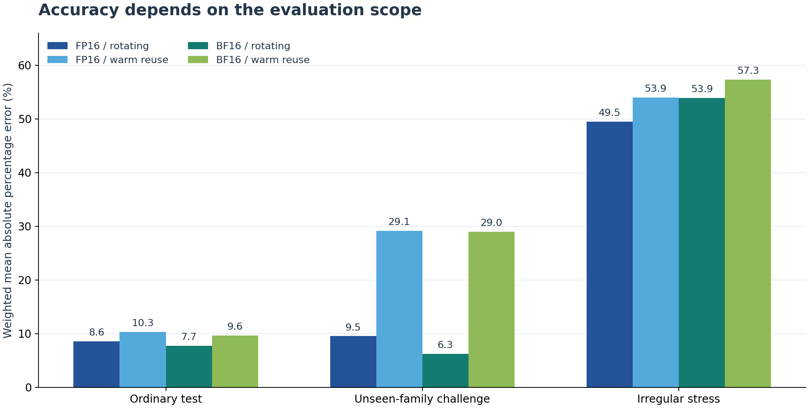

# Recorded A100 experiment — November 6, 2026

**Protocol 1.1.0 · completed CUDA experiment · timing-quality qualifications retained**

This directory publishes the completed `fresh_20261106T065308_c5e789` experiment.
The primary collection, model selection/evaluation, preselected repeat subset,
repeat comparison, and report generation all finished. The optional decoder-layer
stage was not requested. All measurements and selected-model decisions are retained.

The measured device was an **NVIDIA A100-SXM4-40GB**. Primary and repeat stages
have the same recorded GPU UUID and software contexts: Python 3.13.16, PyTorch
2.11.0+cu130, CUDA runtime 13.0, and driver 580.82.07. Matching identity does not
establish locked clocks, fixed thermal conditions, or isolated background load.

## Start here

| File | Purpose |
|---|---|
| [results.zip](results.zip) | Exact completed result archive: raw data, source snapshot, models, traces, logs, manifests, and original reports |
| [review.html](review.html) | Standalone evidence review; download and open in a browser |
| [selected_model_metrics.csv](selected_model_metrics.csv) | Exact copy of all 12 selected-model held-out metric rows |
| [metrics.csv](metrics.csv) | Exact copy of all 60 candidate-model metric rows |
| [publication.json](publication.json) | Experiment identity, source/archive hashes, coverage, and copy mappings |
| [SHA256SUMS.txt](SHA256SUMS.txt) | Checksums for every other published file in this directory |
| [review/](review/) | Offline audit and failure-analysis records, with local review paths normalized for publication |

The archive is approximately 11.3 MB compressed and 201.9 MB expanded. Most
expanded bytes are profiler traces. They are kept in the archive rather than
duplicated as thousands of loose repository files.

After installing the analysis dependencies from the [repository README](../../README.md),
verify the publication on a CPU:

```bash
python scripts/verify_fresh_results.py
```

The verifier checks the fixed result/source hashes, every export-manifest member,
readable metric copies, raw dataset records, saved-model predictions, metric
calculations, grouped-CV records, and paired repeats. It uses the trusted code in
the checkout; it does not execute the archived source or refit any model. Extraction
for verification is temporary. A successful consistency check preserves the
recorded `measurement_quality_passed: false` qualification.

To inspect the original reports, extract into a new directory:

```bash
python -m zipfile -e experiments/a100_20261106/results.zip runs/published_a100_20261106
```

Then open `runs/published_a100_20261106/run/report.html`. The original report links
to the primary model analysis and the repeat comparison. The source snapshot is
inside `source_archive.zip`; its hash identifies the exact acquisition code,
independently of later publication documentation and verification additions.

## Selected-model prediction results

All four contexts selected `roofline_residual_krr` using training-only grouped
cross-validation. Values below are **weighted mean absolute percentage errors**;
lower is better. The weights describe declared architectural operation occurrences
under a synthetic workload mixture, not observed production traffic.

| Precision / buffer policy | Ordinary test | Unseen-family challenge | Irregular stress |
|---|---:|---:|---:|
| FP16 / rotating | 8.56% | 9.53% | 49.47% |
| FP16 / warm reuse | 10.32% | 29.15% | 53.94% |
| BF16 / rotating | 7.71% | 6.26% | 53.93% |
| BF16 / warm reuse | 9.64% | 28.97% | 57.31% |



Ordinary test uses unseen M values within N/K families represented in training.
Challenge holds out complete N/K families. Stress uses artificial +1 changes to
N and K. The two buffer policies have different eligibility coverage and fitted
models, so this table does not isolate a causal cache effect.

Warm reuse has 134 test, 118 challenge, and 46 stress cases per precision;
rotation has 113, 100, and 40. Two warm-only ordinary-test vocabulary shapes also
extrapolate beyond their training-family M range after memory-budget exclusions.
Their low errors do not establish broad extrapolation performance.

The selected model has the lowest ordinary-test weighted mean error among the
five candidates in each context. It does not win every held-out comparison: on
warm challenge, FLOP-only records 17.75% FP16 and 18.58% BF16, below the selected
model's 29.15% and 28.97%. The original CV choice remains unchanged. Full mean,
median, P90, worst-case, and absolute-time metrics are in the linked CSVs.

## Measurement completion and quality

| Evidence | Primary | Repeat |
|---|---:|---:|
| Distinct matrix shapes | 609 | 77 |
| Aggregate precision/cache rows | 2,256 | 280 |
| Raw measurement visits | 6,768 | 840 |
| Control visits | 378 | 72 |
| Profile captures, all with CUDA kernels | 1,218 | 154 |
| Flagged aggregate rows | 6 | 0 |
| Failing control groups | 0 of 6 | 1 of 6 |

The six primary flags reflect differences between visits, not excessive sample
variation within a visit. They comprise three training, two challenge, and one
stress row; none is an ordinary-test row. The repeat FP16 small control has a
maximum/minimum ratio of 1.283567, exceeding the declared 1.20 threshold. No
flagged observations were deleted, and none of the six flagged primary rows was
included in the predetermined repeat subset.

| Precision / buffer policy | Paired cases | Median absolute timing change | P90 change | Largest change |
|---|---:|---:|---:|---:|
| FP16 / rotating | 63 | 1.34% | 4.93% | 12.39% |
| FP16 / warm reuse | 77 | 1.18% | 5.47% | 27.87% |
| BF16 / rotating | 63 | 1.41% | 4.80% | 12.13% |
| BF16 / warm reuse | 77 | 1.61% | 5.14% | 28.19% |

Typical repeat agreement is around 1–2%, with retained tail exceptions. The
repeat is a later subset measurement in the same session, not an independent-day
or cross-device replication. The available traces and coarse telemetry do not
establish the cause of the largest change.

## Scope and known model limits

- The target is CUDA-event elapsed time per preallocated GEMM in a repeated CUDA
  graph, including gaps visible within that event interval. GPU reads and writes
  contribute; allocation, host-device transfers, warmup, profiling, and serving
  queues are excluded.
- Four-buffer rotation is a separate reuse experiment, not a guaranteed cold
  cache or a measurement of HBM traffic. The declared L2 eligibility rule excludes
  180 primary and 28 repeat precision/cache variants; their warm measurements remain.
- Small-matrix predictions can be limited by the selected model's multiplicative
  correction bound of 0.25–4 applied to a zero-overhead roofline baseline. Several
  worst ordinary-test cases have stable measurements but large underprediction.
- All N/K alignment indicators are constant zero in training. Irregular stress
  probes outside that training support and exposes systematic underprediction;
  its corrections are not actively clipped by the small-matrix bound.
- Profiling is separate, warm reuse, and excluded from prediction features and
  targets. Hardware counters were not collected. Kernel names do not establish
  measured Tensor Core utilization, occupancy, cache hit rates, or stall causes.
- Fifteen checkpoint receipts record successful writes and readback verification.
  The final complete archive's Drive-copy outcome is reported outside this ZIP;
  these receipts do not independently confirm its current remote presence.

The [full review](review.html) distinguishes arithmetic-check records, timing
quality, model error, and repeat agreement. It documents the limitations above
without changing the acquisition code, recorded models, or measured targets.
These findings can guide later development; this now-inspected test set should
not be presented as a new untouched evaluation after such changes.

## Archive provenance

Result archive SHA-256:

```text
a601e14bb3d1d2b661f06021432b461104850452ddcc1c695c55006db29374b1
```

Embedded measurement source SHA-256:

```text
1f748883a23d0e9706856493eb011eec88d5e3f8926fafd3874c5d23d2c8345a
```

The original archive and CSV copies are byte-identical to the completed run.
Only derived review metadata replaces local analysis paths with portable
archive-relative references. The earlier published dataset under
[`results/`](../../results/) remains a separate unchanged record.
